# Interface vs the approved wireframes

The interface was re-themed on `feature/ui-theme` (14 October 2026) to
follow the approved SafeGirl wireframes: calm, warm, mobile-first, plain
English, purple and lavender, no alarm colours.

## The wireframes

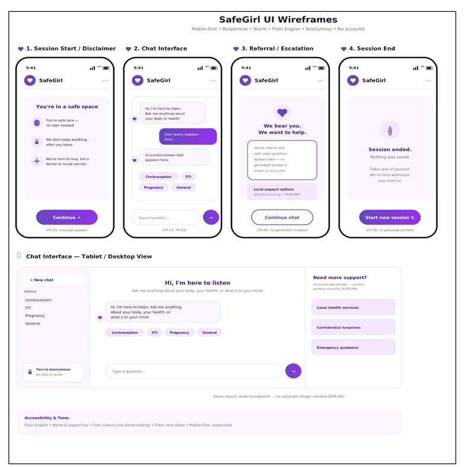

`docs/design/ui-wireframes.png` had not been added to the repository when
the re-theme was done, so the palette was not sampled from the image. It
uses the agreed starting values (primary gradient `#5b2fc7` to `#8b3fe0`,
deep text `#2a1457`, page `#f7f2ff`, lilac `#efe6fc`, border `#d9c9f3`,
white cards) and was refined by eye. Re-check it against the image once
it is added.

## The interface now

Taken from the production build at 390px (phone) and 1280px (desktop).

| Screen | 390px | 1280px |
|---|---|---|
| Session start / disclaimer | 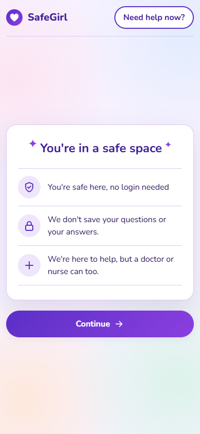 | 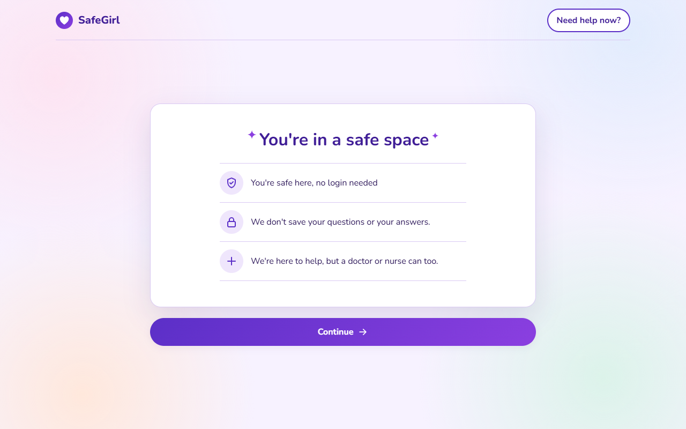 |
| Chat before the first question | 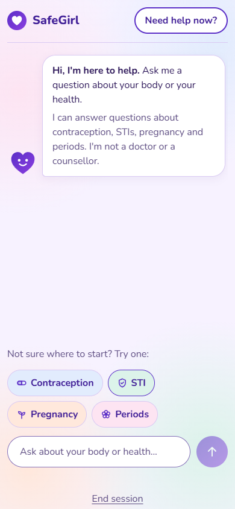 | 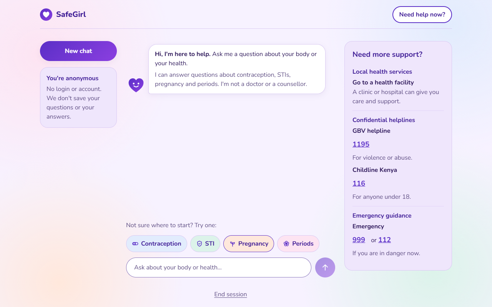 |
| Chat with a reply | 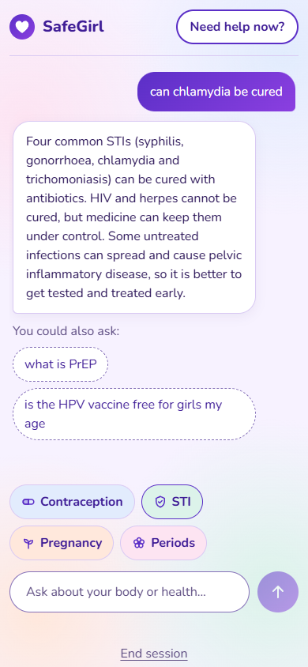 | 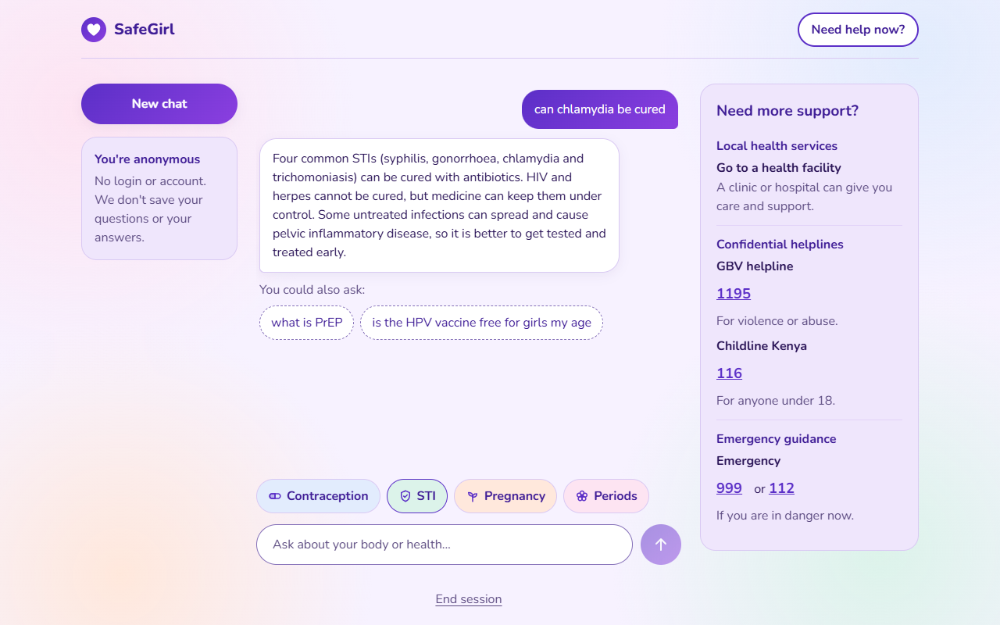 |
| "Need help now?" panel | 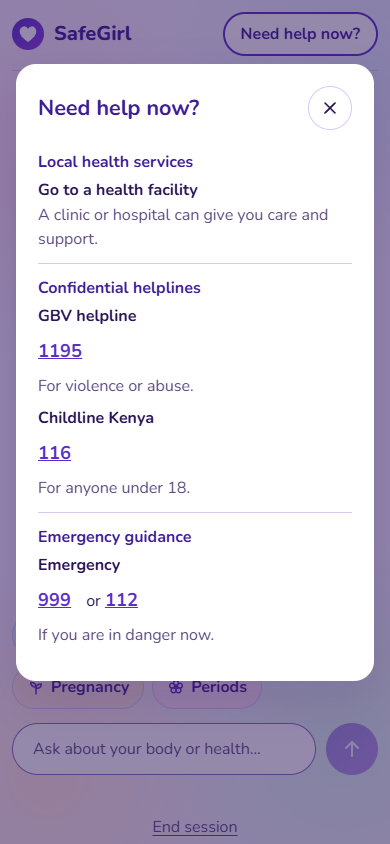 | 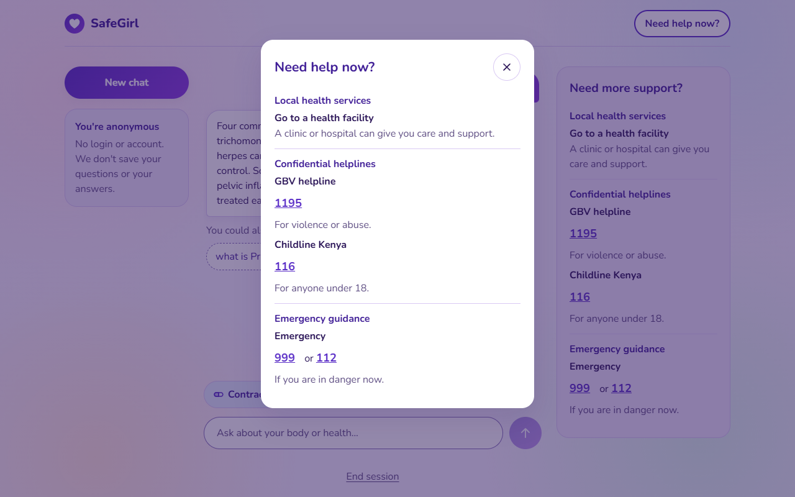 |
| Limited-mode notice | 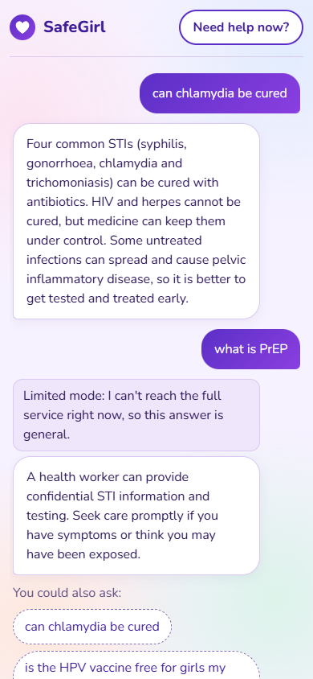 | 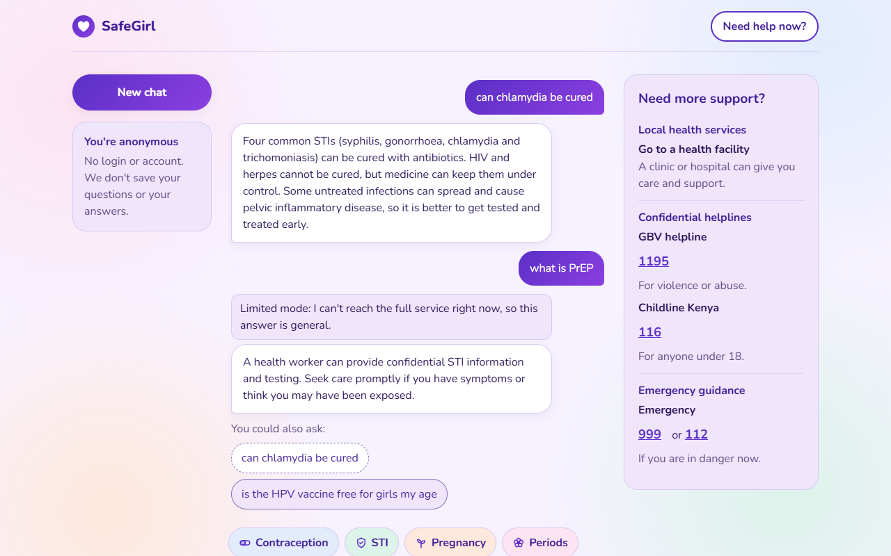 |
| Referral | 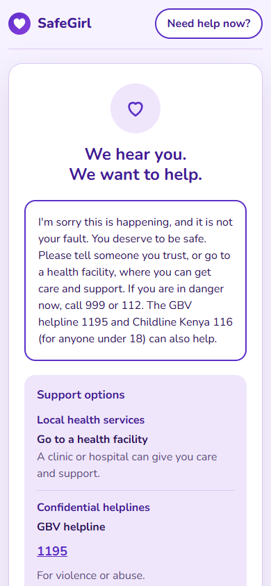 | 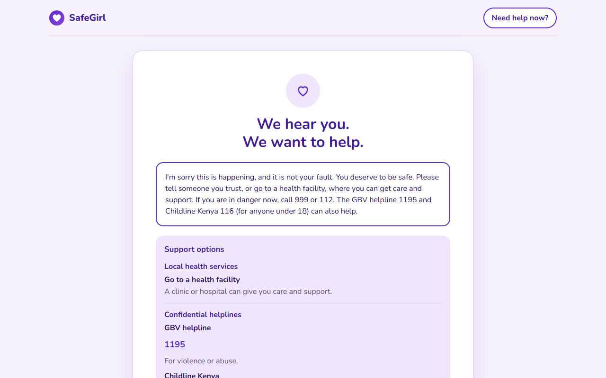 |
| Session end | 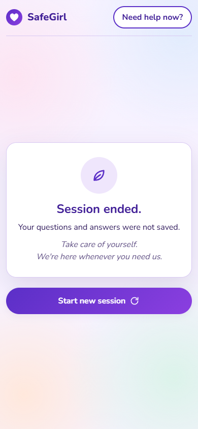 | 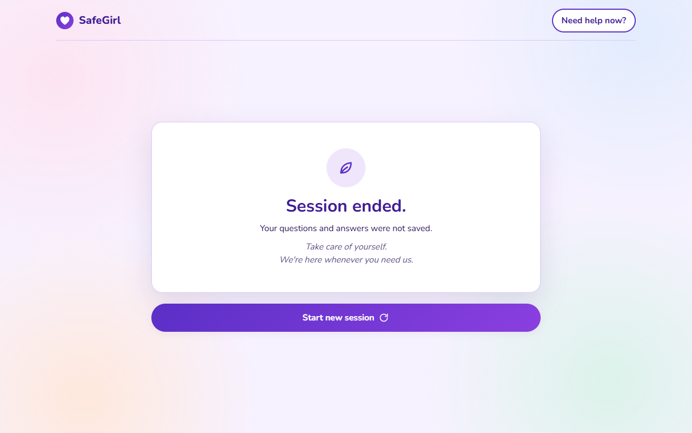 |

How they were taken: headless Chrome against `vite preview`, with
`ml_service` and a local gateway (authentication disabled). The answers
are real. Firebase anonymous sign-in was answered by a stub in the test
browser, because the local Firebase configuration was not available; the
limited-mode shots block `/api/query` to simulate an unreachable service.

## Deliberate differences from the wireframe

| What | Wireframe | Interface | Why |
|---|---|---|---|
| Greeting | "Hi, I'm here to listen. Ask me anything about your body, your health, or what's on your mind." | "Hi, I'm here to help. Ask me a question about your body or your health." plus "I can answer questions about contraception, STIs, pregnancy and periods. I'm not a doctor or a counsellor." | "Ask me anything" and "what's on your mind" invite emotional-support and crisis messages that SafeGirl cannot handle; the scope line sets expectations before the first question. See `docs/decision-log.md` (2026-10-14). |
| Privacy wording | "We don't keep anything after you leave" (disclaimer); "Nothing was saved" (session end) | "We don't save your questions or your answers." / "Your questions and answers were not saved." | The old lines were not literally true: an anonymous Firebase user ID and an SDK heartbeat do exist. The new lines were checked against everything that is stored. See `docs/decision-log.md` (2026-10-14). |
| "Need help now?" button | Help options appear only on the referral screen and, on wide screens, in the side panel | A "Need help now?" button in the header of every screen opens the help options | Help should be one tap away at any time, not only after the Safety Net flags a message, and on phones the side panel is not visible. |
| "Periods" chip | "General" | "Periods" | The chip's example question is about periods, and the greeting's scope line names periods. Only the label changed. See `docs/decision-log.md` (2026-10-14). |
| Limited-mode notice | Not in the wireframe | "Limited mode: I can't reach the full service right now, so this answer is general." above an answer from the offline fallback | Without it, a general offline answer looks like the full service's answer. It appears whenever the online request fails or times out. |
| Support options on the referral screen | Support options panel | The same panel as "Need help now?", from the same content module as the referral message | One source for the numbers, so the referral, the panel and the side panel can never disagree. The numbers are still unverified. |

## Playful update (`feature/ui-playful`)

Added after the re-theme to make the chat friendlier and easier to use
for girls. None of these is in the wireframe; the help panel, the
referral screen and error messages are deliberately left calm (same font
and colours, but no motion, decoration or playful wording), because a
girl may see them at a hard moment.

| What | Detail | Why |
|---|---|---|
| Font | Nunito, a rounded friendly typeface, self-hosted (39 kB, cached for offline); system fonts as the fallback | Warmer than the system font while staying easy to read on cheap screens. Not loaded from Google, so no third party sees who opens SafeGirl. |
| Gentle motion | Bubbles slide in, chips and buttons press in when tapped, three bouncing "typing" dots | Feels responsive and alive. Off for anyone whose device asks for reduced motion, and never on the help or referral screens. |
| Topic chips | Each has an icon and its own pastel colour (pill, shield, sprout, flower) | Topics are recognisable at a glance, even before reading. |
| Prompts | Input placeholder "Ask about your body or health…"; "Not sure where to start? Try one:" above the chips on an empty chat | Tells a first-time user what to do. Stays within SafeGirl's scope (it does not say "ask me anything"). |
| Follow-ups | "You could also ask:" with two questions on the same topic under the latest answer | Always a next step. Every follow-up is a verified "clear" development-set query, and tapping one only fills the input box. |
| Decoration | Soft pastel blobs, small sparkles by the disclaimer title, rounder bubbles, a smiling-heart mascot by the greeting | Playful and warm. The blobs are switched off on the referral screen. |
