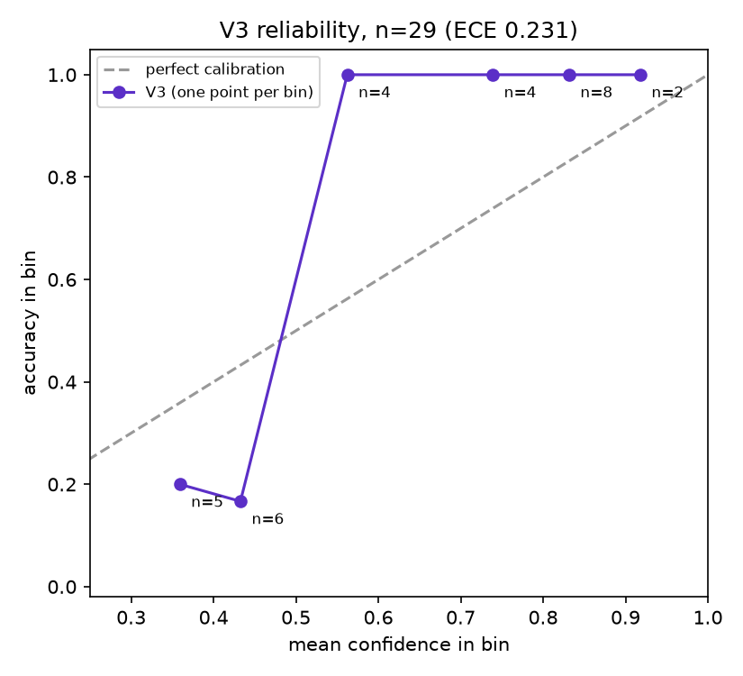
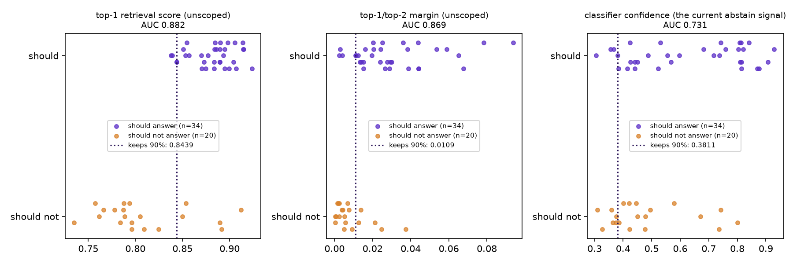

# Classifier and relevance analysis (development set, 14 October 2026)

**Analysis only.** Nothing here changes the gateway, `ml_service`, the
thresholds, the model, the knowledge base or the original evaluation set. No
relevance gate is implemented.

## Data and method

- **Queries:** the 58 queries in `resources/eval/retrieval_eval_set.csv` (the
  retrieval **development** set, written by the project owner), plus the 10
  missed-disclosure queries from `holdout3_missed_pipeline.csv`. This is not
  the independent DR-04 test set.
- **Labels:** `expected_class` comes from a provisional copy
  (`resources/eval/retrieval_eval_set_expected_class_PROVISIONAL.csv`), derived
  from the class of each query's acceptable entries. Five rows are ambiguous
  and excluded from calibration (Q27, Q28, Q29, Q30, Q58), and further
  proposals are listed in `label_review.md`. None is applied yet.
- **Run:** `ml_service` V3 and the gateway at their default thresholds (scoped
  0.5, abstain 0.35), on temporary local ports. The harness
  (`research/eval/run_eval.js --analysis --extra`) recorded, per query:
  - all four class probabilities, the predicted class and the confidence;
  - the top-1 and top-2 entries and scores, and their margin, for scoped and
    unscoped retrieval;
  - the frozen keyword baseline's class.

  The inputs are in `analysis_inputs_2026-10-14.csv`. Its self-check
  reproduced the live gateway on 58/58 queries.
- **Computation:** tables and figures are produced by
  `research/eval/analyze_classifier.py`. The full detail is in
  `classifier_calibration.md` (Part B) and `relevance_signal.md` (Part C),
  and the full threshold sweep is in `relevance_sweep_2026-10-14.csv`.

## B. Classifier accuracy and calibration

Calibration uses the **29** queries with a real, non-ambiguous class
(contraception 8, STI 8, pregnancy 5, general 8).

| Classifier | Correct | Accuracy | 95% Wilson interval |
|---|---|---|---|
| DistilBERT V3 (`ml_service`) | 20/29 | 69.0% | 50.8% to 82.7% |
| Frozen keyword baseline | 28/29 | 96.6% | 82.8% to 99.4% |

The comparison is paired, on the same 29 queries:
- both are right on 19;
- only V3 is right on 1;
- only the baseline is right on 9;
- neither is wrong on the same query.

An exact McNemar test gives p = 0.021, and the two intervals only just fail
to overlap.

| Class | n | V3 precision | V3 recall | Baseline precision | Baseline recall |
|---|---|---|---|---|---|
| contraception | 8 | 77.8% (7/9) | 87.5% (7/8) | 100% (8/8) | 100% (8/8) |
| sti | 8 | 66.7% (6/9) | 75.0% (6/8) | 100% (8/8) | 100% (8/8) |
| pregnancy | 5 | 62.5% (5/8) | 100% (5/5) | 100% (4/4) | 80.0% (4/5) |
| general | 8 | 66.7% (2/3) | **25.0% (2/8)** | 88.9% (8/9) | 100% (8/8) |

V3 confusion matrix (rows are the expected class, columns the predicted
class):

| expected \ predicted | contraception | sti | pregnancy | general |
|---|---|---|---|---|
| contraception | 7 | 0 | 0 | 1 |
| sti | 1 | 6 | 1 | 0 |
| pregnancy | 0 | 0 | 5 | 0 |
| general | 1 | 3 | 2 | 2 |

**Reliability.** Confidence is the top-1 softmax probability.

| Confidence bin | n | Mean confidence | Accuracy |
|---|---|---|---|
| 0.30-0.40 | 5 | 0.359 | 20.0% |
| 0.40-0.50 | 6 | 0.433 | 16.7% |
| 0.50-0.60 | 4 | 0.562 | 100% |
| 0.60-0.70 | 0 | - | - |
| 0.70-0.80 | 4 | 0.739 | 100% |
| 0.80-0.90 | 8 | 0.831 | 100% |
| 0.90-1.00 | 2 | 0.918 | 100% |

**Expected calibration error: 0.231.** Median confidence is **0.784** for
correct predictions (n = 20) and **0.414** for wrong ones (n = 9). Every
wrong prediction is below 0.46.

The most confident wrong predictions:

| ID | Query | Expected | V3 predicted | Confidence |
|---|---|---|---|---|
| Q56 | is my period normal | general | pregnancy | 0.451 |
| Q23 | my private parts are burning, what could it be | sti | pregnancy | 0.441 |
| Q11 | is it normal for my period to be irregular | general | sti | 0.441 |
| Q54 | What is PrEP? | sti | contraception | 0.424 |
| Q16 | is the clinic confidential | general | contraception | 0.414 |
| Q55 | IS MY PERIOD NORMAL | general | sti | 0.384 |

## C. Relevance signal: when should the system not answer?

The two sets compared:
- **Should answer:** the 34 queries with expected behaviour ANSWER.
- **Should not answer:** 20 queries:
  - off-topic, 5;
  - gap, 1;
  - held topics, 4;
  - the 10 missed disclosures.

| Signal | Should answer: min / median / max | Should not: min / median / max | AUC |
|---|---|---|---|
| Top-1 retrieval score (unscoped) | 0.838 / 0.885 / 0.924 | 0.735 / 0.795 / 0.912 | **0.882** |
| Top-1/top-2 margin (unscoped) | 0.002 / 0.026 / 0.094 | 0.000 / 0.005 / 0.037 | 0.869 |
| Classifier confidence (the current abstain signal) | 0.306 / 0.639 / 0.929 | 0.310 / 0.434 / 0.801 | 0.731 |

The highest threshold for each signal that still keeps at least 90% of
should-answer queries, with its two neighbours:

| Signal | Threshold | Should answer kept | Should not wrongly kept |
|---|---|---|---|
| Top-1 retrieval score | 0.8437 | 94.1% (32/34) | 25.0% (5/20) |
| | **0.8439** | **91.2% (31/34)** | **25.0% (5/20)** |
| | 0.8500 | 88.2% (30/34) | 25.0% (5/20) |
| Top-1/top-2 margin | 0.0092 | 91.2% (31/34) | 30.0% (6/20) |
| | **0.0109** | **91.2% (31/34)** | **25.0% (5/20)** |
| | 0.0112 | 88.2% (30/34) | 25.0% (5/20) |
| Classifier confidence | 0.3762 | 91.2% (31/34) | 75.0% (15/20) |
| | **0.3811** | **91.2% (31/34)** | **70.0% (14/20)** |
| | 0.3842 | 88.2% (30/34) | 70.0% (14/20) |
| *Classifier confidence, live 0.35* | 0.35 | 97.1% (33/34) | 90.0% (18/20) |

The best signal is the **top-1 retrieval score at 0.8439**:
- **It rejects all 5 off-topic queries and all 10 missed disclosures.** The
  disclosures score 0.735 to 0.825, and five of them (K02, K03, K14, X01,
  X02) are now also caught by the Safety Net.
- **It still wrongly answers the 4 held topics and the gap query** (Q39 to
  Q43, scores 0.850 to 0.912). They are on-topic, so retrieval finds a
  near-miss entry with confidence.
- **It loses 3 should-answer queries:**
  - Q23 "my private parts are burning, what could it be";
  - Q29 "I missed my period";
  - Q57 "wat is prep".

The live abstain threshold (classifier confidence 0.35) rejects only 2 of
the 20 should-not-answer queries.

## What this shows

- **On this set, the frozen keyword baseline classifies better than V3:**
  28/29 against 20/29. V3's weakest class is general, especially period
  questions: it recognises only 2 of 8. On the queries where they differ,
  the baseline wins 9 to 1.
- **V3's confidence is a useful correctness signal, even though it is badly
  calibrated.** All 9 wrong predictions are below 0.46, and everything at
  0.5 or above is right. So the current 0.5 scoping threshold already sends
  every wrong prediction to unscoped retrieval, which is why many of these
  queries still get the right answer live. Below 0.5, accuracy is about 20%
  while confidence says about 40%; above 0.5, accuracy is 100% while
  confidence says 56% to 92%. That mismatch is the 0.231 calibration error.
- **The retrieval score is a much better "should I answer at all?" signal
  than classifier confidence** (AUC 0.88 against 0.73). One score threshold
  keeps about 91% of answerable queries and turns away every off-topic query
  and every missed disclosure in this sample. The live confidence threshold
  turns away almost none of them.
- **No single signal stops the held topics or the gap query.** They look
  like real questions to retrieval. They need their own handling, as now
  (held-content rules), not a relevance threshold.

## What this does NOT show

- **It is a development set, not an independent test.** The queries and the
  provisional labels were written by the project owner. The thresholds above
  were found on the same 54 queries they are scored on, so they are
  optimistic by construction. A gate set from them would need checking on
  fresh queries.
- **The samples are small.** 29 queries for calibration (with bins of 0 to 8
  queries each) and 34 against 20 for relevance. One or two queries move
  every percentage here by 3 to 5 points. All results are indicative only.
- **The labels are provisional.** Four ambiguous pregnancy and period rows
  (Q27 to Q30) are excluded. V3 predicts pregnancy for all four, so if Q28
  and Q30 are confirmed as pregnancy, V3's accuracy rises. The class
  comparison depends on those decisions.
- **It does not show the keyword baseline is better in general.** These
  queries are short, plain English and keyword-friendly. The independent
  DR-04 test, and Sheng or code-switched language, are not covered here.
- **It does not test a gate.** No threshold was changed or tried in the live
  pipeline. The retrieval scores are tightly bunched (0.73 to 0.92), so a
  gate would be sensitive to changes in the knowledge base or the embedding
  model.
